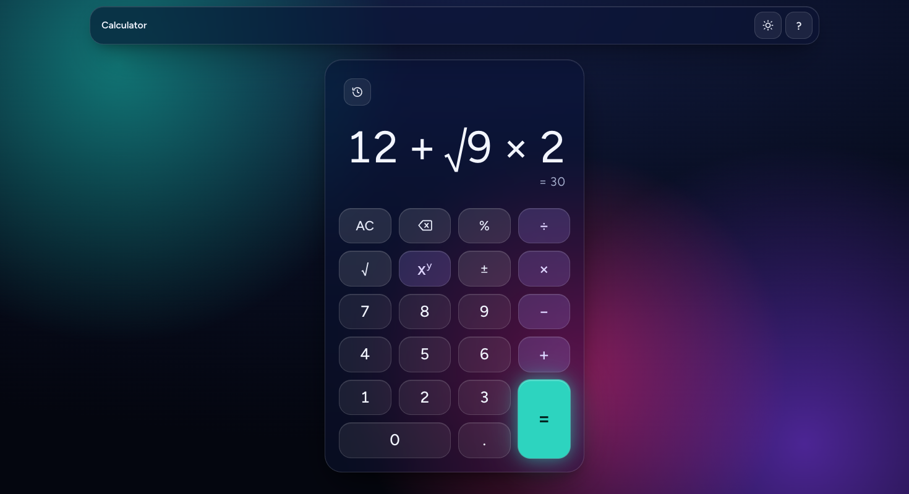
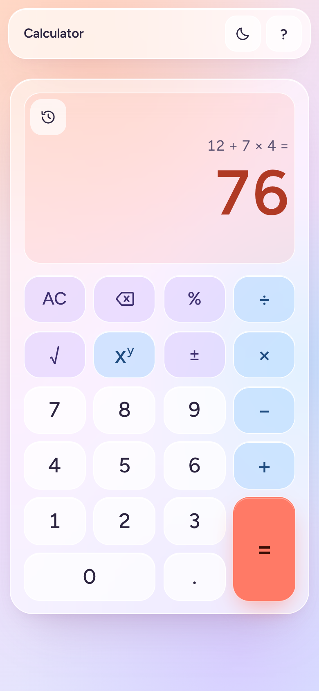

# Calculator

A full-stack calculator with a frosted-glass interface. The React + TypeScript frontend handles input and display, and
the Go REST API does **all** the maths. It supports add, subtract, multiply, divide, power, square root and percentage.
It works on phones, tablets and laptops, can be used entirely from the keyboard, has light and dark themes, and keeps a
history of past calculations in the browser.

| Laptop, dark theme (typing `12 + √9 × 2`, live result faded below; history opens with the top-left button) | Phone, light theme (a finished result) |
|---|---|
|  |  |

---

## 1. Quick start (Docker)

You need Docker (Docker Desktop on macOS/Windows) and nothing else.

```bash
docker compose up --build
```

Open **http://localhost:8080**. Stop it with `Ctrl+C`, or with `docker compose down` if you started it with `-d`.

One image holds everything: the Go server serves both the API and the built frontend, from one address.

| URL | What it is |
|---|---|
| http://localhost:8080 | The calculator |
| http://localhost:8080/docs | Swagger UI (interactive API docs). **Needs internet**: Swagger UI's files load from a CDN. The calculator itself works offline. |
| http://localhost:8080/openapi.json | The OpenAPI 3.0 spec |
| http://localhost:8080/health | Health check: `{"status":"ok"}` |

The image is about 23 MB, runs as a non-root user, and reports its health to Docker. `docker stop` shuts the server down
gracefully: requests that are already running are allowed to finish.

---

## 2. Running without Docker

Prerequisites (the versions this was built and tested with):

| Tool | Version |
|---|---|
| Go | 1.27.4 |
| Node.js | 24.18.0 (with npm) |

Node.js is needed even without Docker: the frontend is TypeScript and has to be built once by Node before a browser
can run it. With Go alone you can run the API (and `/docs`), but not the calculator page.

### Option A: one server, like Docker (http://localhost:8080)

Build the frontend once, then let the Go server serve it together with the API:

```bash
cd frontend
npm ci
npm run build                  # writes frontend/dist
cd ../backend
STATIC_DIR=../frontend/dist go run ./cmd/server
```

Open **http://localhost:8080**. Stop it with `Ctrl+C`. Rebuild the frontend (`npm run build`) after changing it.
(On Windows PowerShell, set the variable first: `$env:STATIC_DIR="../frontend/dist"; go run ./cmd/server`.)

### Option B: development mode, with live reload (http://localhost:5173)

Run the backend and the frontend in two terminals:

```bash
# Terminal 1: API on http://localhost:8080
cd backend
go run ./cmd/server
```

```bash
# Terminal 2: frontend dev server on http://localhost:5173
cd frontend
npm install
npm run dev
```

Open **http://localhost:5173**. The Vite dev server forwards every `/api` request to the Go server on port 8080, so the
browser only ever talks to one address and no CORS setup is needed.

When run this way, the backend logs `static directory not found; only the API will be served`, and
http://localhost:8080 itself shows `404 page not found` (while http://localhost:8080/health answers). That is expected:
in development the page comes from Vite on **5173**, and port 8080 is only the API.

Server settings (environment variables):

| Variable | Default | Meaning |
|---|---|---|
| `PORT` | `8080` | Port to listen on |
| `STATIC_DIR` | `./static` | Folder with the built frontend (set to `/app/static` in the Docker image) |

Other frontend commands: `npm run build` (type-check + production build into `frontend/dist`), `npm run typecheck`.

---

## 3. Tests and coverage

```bash
# Backend
cd backend
go test ./...                                    # 152 test cases
go test -coverpkg=./... -coverprofile=coverage/coverage.out ./...
go tool cover -html=coverage/coverage.out -o coverage/coverage.html

# Fuzz tests (random inputs; each runs until stopped or for -fuzztime)
go test -run='^$' -fuzz='^FuzzCalculate$' -fuzztime=60s ./internal/api/
go test -run='^$' -fuzz='^FuzzCalculateNumbers$' -fuzztime=60s ./internal/calculator/
```

```bash
# Frontend
cd frontend
npm test              # 201 tests (Vitest + Testing Library, in a simulated browser)
npm run coverage      # writes frontend/coverage/index.html
```

Latest results:

| | Tests | Coverage |
|---|---|---|
| Backend | 152 passing | 91.9% of statements, across all packages |
| Frontend | 201 passing | 97.76% of statements, 98.48% of lines |
| Fuzzing | 60 s each, no failures | about 5.4 million random API requests and 21.6 million random maths inputs |

Coverage reports (committed, so they can be opened without running anything): `backend/coverage/coverage.html` and
`frontend/coverage/index.html`.

What the tests cover, in short:

- **Backend:** every operation and error code, IEEE-754 edge cases (`0^0`, `0^-1`, `(-8)^0.5`, overflow, `-0`), malformed
  JSON, unknown fields, `null` operands, oversized bodies, wrong methods, and unknown routes. A test fails if the OpenAPI
  spec drifts from the code. Server tests cover start-up, serving, a port already in use, and graceful shutdown.
- **Frontend:**
  - every key's behaviour, including Backspace stepping back through a calculation and √ before a number;
  - the 15-digit input limit, number formatting, and the API client's errors and timeout;
  - history storage, including corrupt or blocked storage;
  - keyboard-only use: Enter on a focused button, the shortcut keys, the dialogs and the history sheet;
  - themes, and backend failures.

The Docker image was also checked in real Chrome: all screen sizes, both themes, reduced motion, holding keys down,
stopping the backend mid-session, and every API error through `curl`.

---

## 4. API

### `POST /api/v1/calculate`

Request: an `operation` and its `operands` (2 numbers, or 1 for `sqrt` and `percentage`).

```json
{ "operation": "divide", "operands": [10, 4] }
```

Success, `200`:

```json
{ "result": 2.5 }
```

Every error has the same shape:

```json
{ "error": { "code": "DIVISION_BY_ZERO", "message": "Cannot divide by zero." } }
```

| `operation` | Operands | Result |
|---|---|---|
| `add` | `[a, b]` | a + b |
| `subtract` | `[a, b]` | a − b |
| `multiply` | `[a, b]` | a × b |
| `divide` | `[a, b]` | a ÷ b |
| `power` | `[a, b]` | a to the power b |
| `sqrt` | `[a]` | square root of a |
| `percentage` | `[a]` | a ÷ 100 (so 50 → 0.5) |

### Error codes

| HTTP | `code` | When |
|---|---|---|
| 400 | `INVALID_JSON` | Body is not one JSON object: empty, malformed, trailing data, an unknown field, a wrong type (e.g. `"5"`), or a number outside double range (e.g. `1e999`) |
| 400 | `INVALID_OPERATION` | `operation` missing or not one of the 7 |
| 400 | `INVALID_OPERANDS` | `operands` missing, the wrong count, or contains `null` |
| 413 | `PAYLOAD_TOO_LARGE` | Body larger than 1 KiB |
| 422 | `DIVISION_BY_ZERO` | Dividing by 0, or 0 to a negative power |
| 422 | `NEGATIVE_SQRT` | Square root of a negative number |
| 422 | `UNDEFINED_RESULT` | The result is not a number, e.g. (−8) ^ 0.5 |
| 422 | `OVERFLOW` | The result is too large for a double, e.g. 10 ^ 400 |
| 405 | `METHOD_NOT_ALLOWED` | Anything but `POST` on `/api/v1/calculate` (with an `Allow: POST` header) |
| 404 | `NOT_FOUND` | Unknown `/api/...` path |
| 500 | `INTERNAL_ERROR` | Unexpected failure (details are logged, never sent to the client) |

### `curl` examples

The outputs below are real responses from the server.

```bash
curl -X POST http://localhost:8080/api/v1/calculate -d '{"operation":"add","operands":[12,7]}'
# {"result":19}

curl -X POST http://localhost:8080/api/v1/calculate -d '{"operation":"subtract","operands":[10,25]}'
# {"result":-15}

curl -X POST http://localhost:8080/api/v1/calculate -d '{"operation":"multiply","operands":[19,4]}'
# {"result":76}

curl -X POST http://localhost:8080/api/v1/calculate -d '{"operation":"divide","operands":[10,4]}'
# {"result":2.5}

curl -X POST http://localhost:8080/api/v1/calculate -d '{"operation":"power","operands":[2,10]}'
# {"result":1024}

curl -X POST http://localhost:8080/api/v1/calculate -d '{"operation":"sqrt","operands":[144]}'
# {"result":12}

curl -X POST http://localhost:8080/api/v1/calculate -d '{"operation":"percentage","operands":[50]}'
# {"result":0.5}
```

Errors (the HTTP status is shown in brackets):

```bash
curl -X POST http://localhost:8080/api/v1/calculate -d '{"operation":"divide","operands":[8,0]}'
# [422] {"error":{"code":"DIVISION_BY_ZERO","message":"Cannot divide by zero."}}

curl -X POST http://localhost:8080/api/v1/calculate -d '{"operation":"sqrt","operands":[-4]}'
# [422] {"error":{"code":"NEGATIVE_SQRT","message":"Cannot take the square root of a negative number."}}

curl -X POST http://localhost:8080/api/v1/calculate -d '{"operation":"power","operands":[10,400]}'
# [422] {"error":{"code":"OVERFLOW","message":"The result is too large."}}

curl -X POST http://localhost:8080/api/v1/calculate -d '{"operation":"modulo","operands":[1,2]}'
# [400] {"error":{"code":"INVALID_OPERATION","message":"\"operation\" must be one of: add, divide, multiply, percentage, power, sqrt, subtract."}}

curl -X POST http://localhost:8080/api/v1/calculate -d '{"operation":"divide","operands":[5,null]}'
# [400] {"error":{"code":"INVALID_OPERANDS","message":"\"operands\" must not contain null."}}

curl http://localhost:8080/api/v1/calculate
# [405] {"error":{"code":"METHOD_NOT_ALLOWED","message":"Method GET is not allowed. Use POST."}}
```

The full, interactive reference is Swagger UI at **http://localhost:8080/docs**.

---

## 5. Using the calculator

It works like a phone calculator. Each operation runs as soon as you enter the next one, left to right, with no operator
precedence: `2 + 3 × 4 = 20`.

- **While typing**, the large bright line shows the whole expression (`12 + 7 × 4`), and the faded line below shows its
  result so far (`= 76`), updated on every key press.
- **After `=`**, the result is large and highlighted, with the finished expression above it, and the calculation is
  saved to history.
- **Backspace never gets stuck.** It deletes digits, then steps back over operators and earlier numbers
  (`12 + 5` → `12 +` → `12`). After a result it returns to the expression for editing, and after an error it returns to
  the input so you can fix it.
- **√ and %** apply to the number you just typed (`9` then `√` → `√9`). Pressed before a number, √ waits for it
  (`12 +` then `√` then `9` → `12 + √9` = 15). The same goes for ± (`12 +` then `±` then `5` → `12 + −5`).
- **History** is hidden until you ask for it: press the history button (top-left of the display) or `h`. On laptops and
  tablets it opens beside the calculator, and you can keep typing while it is open. On phones it slides up as a sheet.
  Click a row to reuse its result. **Clear** empties it.
- **The whole calculator fits the window** without scrolling on laptops and tablets: the keys shrink on shorter windows,
  but never below a 44 px touch target. (On very small phones such as a 375×667 iPhone SE, the page scrolls a little.)

### Keyboard shortcuts

Press `?` in the app to see this list.

| Key | Action |
|---|---|
| `0`–`9`, `.` (`,` also works) | Type a number |
| `+` `-` `*` `/` | Add, subtract, multiply, divide |
| `^` | Power |
| `%` | Percent |
| `r` | Square root |
| `n` | Change sign (±) |
| `Enter` or `=` | Equals |
| `Backspace` | Delete, or step back |
| `Esc` or `Delete` | Clear (AC). `Esc` first closes an open dialog or sheet. |
| `↑` `↓` `←` `→` | Move between the on-screen keys (once a key has focus, e.g. after `Tab`) |
| `h` | Show or hide history |
| `t` | Switch light / dark theme |
| `?` | Show the shortcuts |

Keys pressed together with Ctrl, Cmd or Alt are ignored, so browser shortcuts still work. If you reach a button with
`Tab` or the arrow keys, `Enter` presses that button. Otherwise `Enter` means `=`.

---

## 6. Design decisions and assumptions

- **Phone-style evaluation:** left to right, no operator precedence (`2 + 3 × 4 = 20`).
- **The backend does all the maths;** the frontend only handles input and display (`12 + √9` → `sqrt(9)`, then `add(12, 3)`).
- **Live preview** on every key press; outdated requests are cancelled and key presses are processed in order.
- **Percentage is simple:** `x% = x ÷ 100`, so `50%` → `0.5`. A number typed straight after `%` multiplies it, as on
  phone calculators: `32 % 2` reads `32% × 2` and gives `0.64`.
- **15-digit input limit:** a double stores 15 digits exactly; results are rounded to 15 significant digits (`0.1 + 0.2` → `0.3`).
- **The API never returns `Infinity` or `NaN`:** they become `OVERFLOW` / `UNDEFINED_RESULT` errors.
- **Status codes:** `400` for a malformed request, `422` for impossible maths (e.g. divide by zero). Unknown fields and `null` operands are rejected.
- **Go standard library only;** Go serves the API and the frontend from one address, so no CORS is needed.
- **History** is kept in the browser (`localStorage`), capped at 50 entries.
- **Swagger UI** (`/docs`) loads from a CDN, so it needs internet; the calculator itself does not.
- **No accounts or authentication.**

---

## 7. Project structure

```
.
├── Dockerfile               # 3 stages: build frontend (Node) → build server (Go) → small Alpine runtime
├── compose.yaml             # `docker compose up --build` → http://localhost:8080
├── backend/                 # Go module "calculator" (standard library only)
│   ├── cmd/server/          # main: configuration, timeouts, graceful shutdown
│   └── internal/
│       ├── calculator/      # the maths: operations, validation, IEEE-754 result checks
│       ├── api/             # HTTP: routes, JSON decoding, error mapping, request logging
│       └── docs/            # embedded openapi.json + Swagger UI page
├── frontend/                # React 19 + TypeScript + Vite
│   └── src/
│       ├── domain/          # pure logic: state machine, typing rules, number formatting, key map
│       ├── api/             # API client (timeout, error handling)
│       ├── hooks/           # backend queue + live preview, history, theme, keyboard, modal focus
│       ├── components/      # display, keypad, history panel/sheet, shortcuts dialog, top bar
│       ├── styles/          # design tokens (light + dark) and global styles
│       └── test/            # test setup and a fake backend
├── design/                  # the design system the UI follows (tokens and component notes)
├── docs/
│   ├── PLAN.md              # requirements, decisions, specification, deviations
│   └── screenshot-*.png     # README screenshots
└── PROMPTS.md               # the prompts used to plan, design, build and improve the project
```
